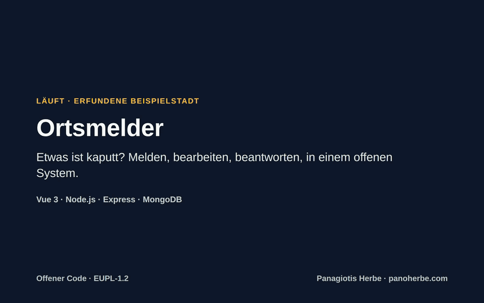
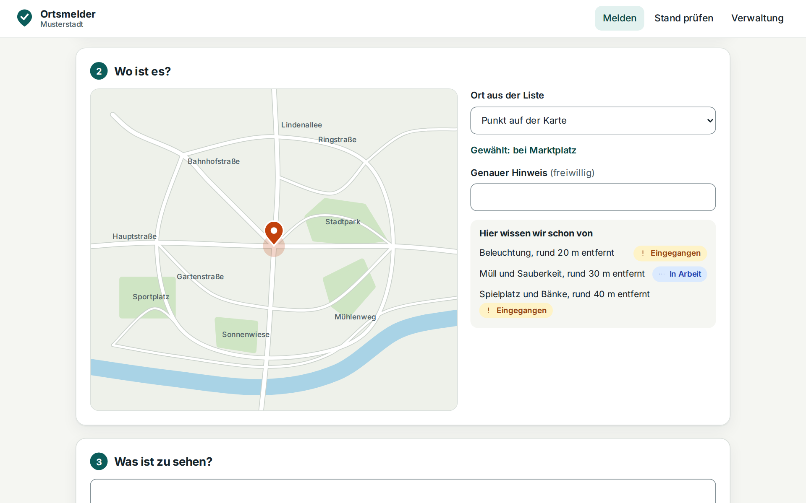
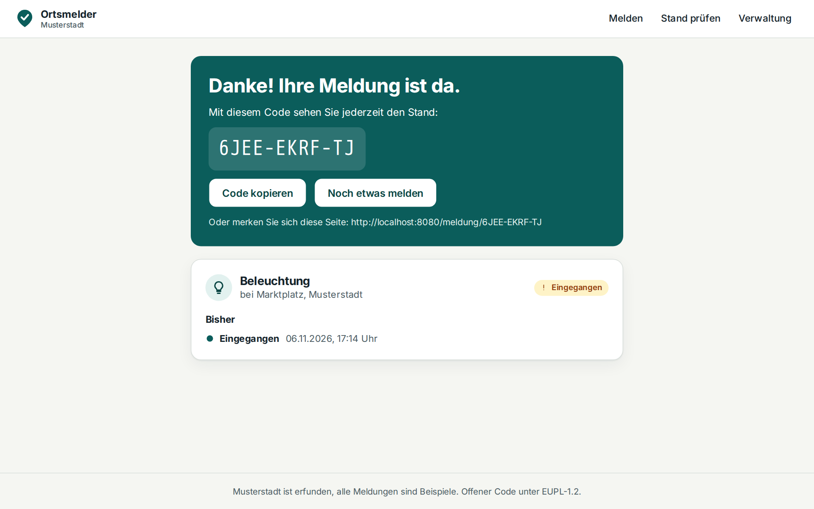
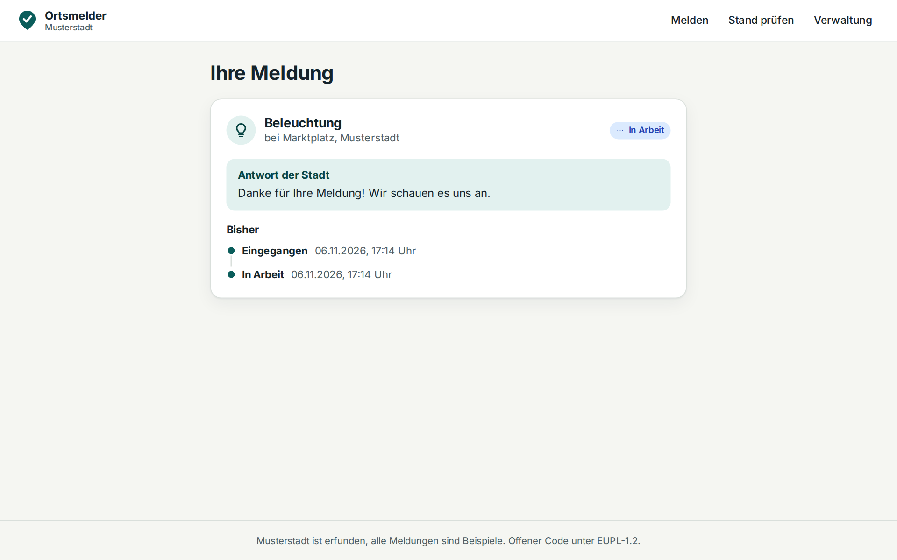
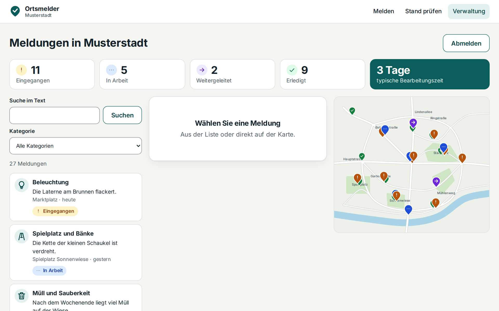
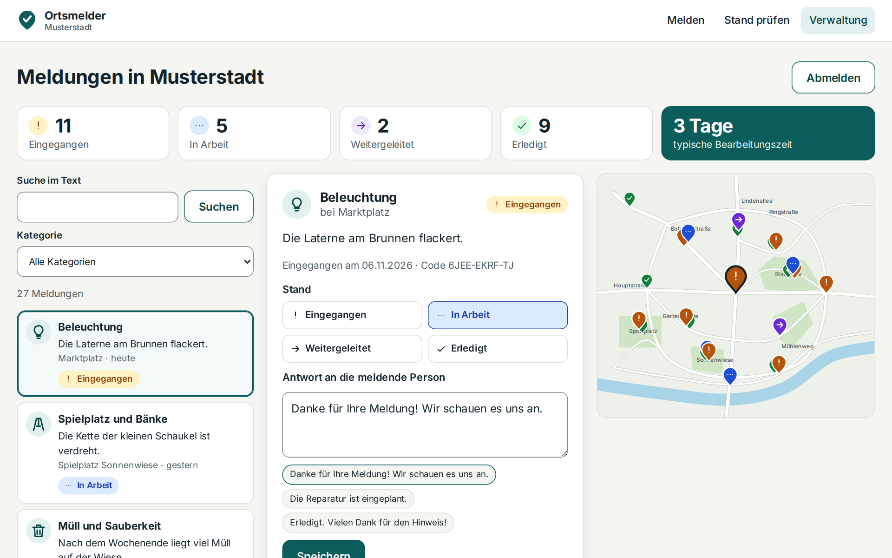
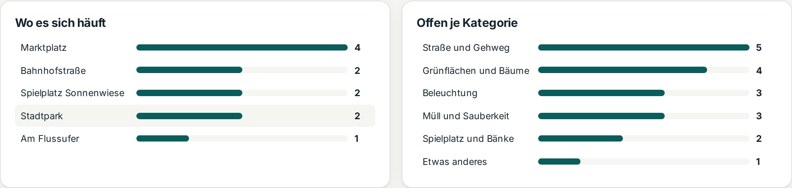
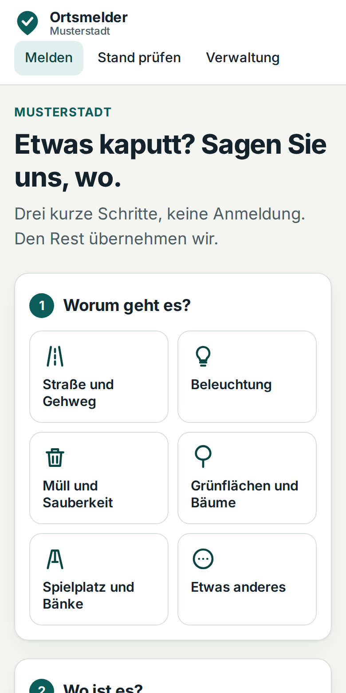

<div align="center">

# Ortsmelder

**Bürgerinnen und Bürger melden, was im Ort kaputt ist. Die Verwaltung sieht es sofort, kümmert sich und antwortet.**

Läuft heute, mit einem Befehl, als offener Code unter EUPL-1.2.

</div>



**Rundgang, 79 Sekunden, ohne Ton.** [Als MP4 herunterladen](medien/rundgang.mp4) (2 MB). Stadt und Meldungen sind erfunden.

<details>
<summary>Untertitel als Text</summary>

<!-- untertitel -->

- 0:00 Titel: Ortsmelder. Etwas ist kaputt? Melden, bearbeiten, beantworten, in einem offenen System.
- 0:04 Eine Laterne flackert. Melden geht ohne Anmeldung, in drei kurzen Schritten.
- 0:08 Erst die Kategorie.
- 0:11 Dann der Ort: ein Klick auf die Karte oder ein Griff in die Liste.
- 0:14 Die Umkreissuche in MongoDB zeigt sofort, was hier schon bekannt ist.
- 0:21 Ein, zwei Sätze genügen. Namen braucht es nicht.
- 0:24 Fertig. Mit diesem Code sieht die meldende Person jederzeit den Stand.
- 0:28 Die Verwaltung meldet sich mit ihrem Schlüssel an, hier dem der Demo.
- 0:32 Alles auf einen Blick: Stand, Liste und Karte. Die Zahlen kommen aus einer MongoDB-Aggregation.
- 0:37 Die neue Meldung ist da, ihr Pin auf der Karte hervorgehoben.
- 0:42 Stand setzen, antworten. Ein Textbaustein spart das Tippen.
- 0:46 Darunter steht, was im Umkreis noch offen ist. So fällt eine Häufung gleich auf.
- 0:50 Gespeichert. Wenn zwei gleichzeitig ändern, kommt nur eine Änderung durch, die andere Person erfährt es.
- 0:55 Wo es sich häuft und was je Kategorie offen ist. Ein Klick filtert die Liste.
- 0:59 Und bei der meldenden Person kommt an: In Arbeit, mit der Antwort der Stadt.
- 1:03 Auch auf dem Telefon: Dieselbe Seite passt sich an, mit der Tastatur ist sie ebenso bedienbar.
- 1:07 Gemessen am 06.11.2026: 195 Tests bestanden, davon 74 gegen echtes MongoDB 7 und 32 im echten Browser; 0 axe-Verstöße in 18 Prüfungen.
- 1:13 Selbst ausprobieren: docker compose up --build. Die Stadt und alle Meldungen sind erfunden.

<!-- /untertitel -->

</details>

## So sieht es aus

### Melden: drei Schritte, keine Anmeldung

Kategorie wählen, Ort auf der Karte antippen, ein, zwei Sätze schreiben. Was in der Nähe schon bekannt ist, steht gleich
daneben.



### Danke sagen und den Stand zeigen

Wer meldet, bekommt einen Code und sieht damit jederzeit, wie es steht.

| Direkt nach dem Melden                              | Später, mit der Antwort der Stadt                            |
| --------------------------------------------------- | ------------------------------------------------------------ |
|  |  |

### Verwalten: alles auf einen Blick

Stand, Liste und Karte auf einer Seite. Ein Klick auf eine Zahl filtert die Liste, ein Klick auf einen Pin öffnet die
Meldung.



### Bearbeiten: Stand setzen, antworten, fertig

Textbausteine sparen das Tippen. Darunter steht, was im Umkreis noch offen ist.



### Sehen, wo es sich häuft



### Auch auf dem Telefon



## Was Sie brauchen → läuft hier schon

Alle Zahlen sind gemessen am 06.11.2026, Belege in [`nachweis/2026-11-06/`](nachweis/2026-11-06/).

| Was Sie brauchen              | Läuft hier schon                                                                                                 |
| ----------------------------- | ---------------------------------------------------------------------------------------------------------------- |
| Melden ohne Hürde             | Keine Anmeldung, keine App, das Formular fragt nicht nach Name oder E-Mail                                       |
| Doppelmeldungen früh erkennen | Schon beim Melden zeigt die Umkreissuche, was in 150 m bekannt ist                                               |
| Eine Antwort, die ankommt     | Stand und Antwort sind über den Code sichtbar                                                                    |
| Überblick für die Verwaltung  | Zahlen je Stand, typische Bearbeitungszeit, Schwerpunkte je Ort, offene Meldungen je Kategorie                   |
| Für alle bedienbar            | Ohne Maus nutzbar; **0 Verstöße** in **18** automatischen axe-Prüfungen (WCAG 2.2 A und AA, Desktop und Telefon) |
| Kein Abfluss an Dritte        | Die Seite lädt nichts von fremden Servern; im Browser geprüft                                                    |
| Schutz vor Missbrauch         | Aufrufbegrenzung am Formular und an der Anmeldung, geschützte Verwaltung, strenge Sicherheits-Header             |
| Verlässlichkeit               | **195** automatische Tests bestanden, davon **74** gegen echtes MongoDB 7 und **32** im echten Browser           |
| Schneller Start               | Aus einem sauberen Klon gebaut und gestartet in **16 Sekunden** (Basis-Images schon geladen)                     |

## Selbst prüfen

Sie brauchen nur [Docker](https://www.docker.com/products/docker-desktop/).

```bash
git clone https://github.com/panoherbe/ortsmelder.git
cd ortsmelder
docker compose up --build
```

Dann [localhost:8080](http://localhost:8080) öffnen und etwas melden. In die Verwaltung kommen Sie mit dem Schlüssel
`demo-verwaltung`, er steht auch auf der Anmeldeseite.

## Ihr Vorteil: Sie sehen ein laufendes System, kein Versprechen

Jede Aussage oben können Sie auf Ihrem eigenen Rechner nachstellen. Der Code gehört niemandem exklusiv: Die EUPL-1.2 ist
die offene Lizenz der Europäischen Union. Sie dürfen ihn nutzen, anpassen und unter dieser Lizenz weitergeben.

## Was ein echter Einsatz ergänzt

Musterstadt ist eine gezeichnete Beispielstadt. Für einen echten Ort kommen dazu: die Karte und die Orte der Stadt (eine
Datei, siehe [`docs/BETRIEB.md`](docs/BETRIEB.md)), Impressum und Datenschutzhinweise, Löschfristen, HTTPS und Sicherung
am Standort. Fotos an Meldungen, Konten je Person und Benachrichtigung per E-Mail sind noch nicht enthalten. Geprüft ist
automatisch; ein Test mit echten Screenreadern und unter hoher Last steht noch aus.

## Kontakt

Panagiotis Herbe · [panoherbe.com](https://panoherbe.com)

---

## Technik für die IT

**Stapel:** Vue 3 mit Vite und Vitest · Node.js 22 mit Express 5 · MongoDB 7 mit Mongoose · Docker Compose · ESLint und
Prettier · Playwright und axe-core.

**Prüfen, alles in Containern, ein Befehl:**

```bash
./pruefen.sh
```

Läuft ESLint, Prettier, Vitest (Oberfläche, API, echtes MongoDB 7 im Container), dann Browser-Tests und axe gegen den
fertig gebauten Stapel. Ergebnis in `pruefung/ergebnis.json`. Mit vorhandenen Images gemessen 60 Sekunden; beim
ersten Mal kommen die Downloads dazu, vor allem das Browser-Image (über 0,7 GB).

| Testgruppe                 | Bestanden |
| -------------------------- | --------- |
| Oberfläche (Vitest, jsdom) | 67        |
| API, Einheiten             | 22        |
| API, echtes MongoDB 7      | 74        |
| Browser (Playwright)       | 32        |
| **Gesamt**                 | **195**   |

**MongoDB in diesem Projekt:**

- GeoJSON-Punkte mit `2dsphere`-Index; `$geoNear` für die Umkreissuche ([`api/src/abfragen.js`](api/src/abfragen.js)), ein
  Test belegt die Nutzung des Index über den Abfrageplan.
- Aggregation mit `$facet`, `$dateDiff` und `$median` für die Kennzahlen in einem Durchgang.
- Deutscher Volltextindex: Die Suche nach „Laterne“ findet „Laternen“.
- TTL-Index räumt abgelaufene Sitzungen ab.
- Atomare Änderung über `findOneAndUpdate` mit der Version im Filter; von fünf gleichzeitigen Änderungen kommt im Test
  genau eine durch, die anderen erhalten HTTP 409.

**Vue in diesem Projekt:** Vue 3 mit Composition API und `<script setup>`, Vue Router, eine eigene SVG-Karte
([`web/src/teile/OrtsKarte.vue`](web/src/teile/OrtsKarte.vue)) mit Klick, Pfeiltasten und bedienbaren Pins, Fokusführung
beim Seitenwechsel, Fehlermeldungen je Feld.

**Sicherheit:** Verwaltungsschlüssel, daraus eine Sitzung im HttpOnly-Cookie mit `SameSite=Strict`, in der Datenbank nur
als Hash; Drosselung falscher Anmeldungen; Eingaben mit zod geprüft, Operatoren in Filtern werden abgewiesen; CSP ohne
`unsafe-inline`; außerhalb der Demo startet der Server nicht ohne Schlüssel von mindestens 16 Zeichen. Die Öffentlichkeit
sieht nie den Freitext einer Meldung.

**Weiter lesen:** [`docs/BETRIEB.md`](docs/BETRIEB.md) (Einstellungen, echter Betrieb) ·
[`docs/ORTSMELDER-HANDOVER.md`](docs/ORTSMELDER-HANDOVER.md) (Aufbau, Fallen, Runbooks) ·
[`nachweis/`](nachweis/) (Messstände).

**Lizenz:** [EUPL-1.2](LICENSE). Schrift: Inter (SIL Open Font License), lokal ausgeliefert.
